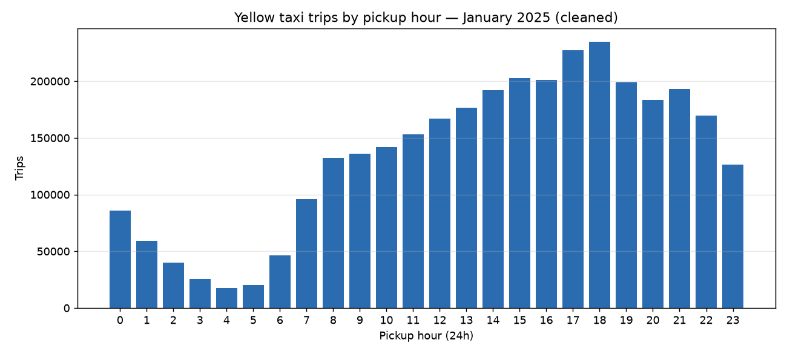
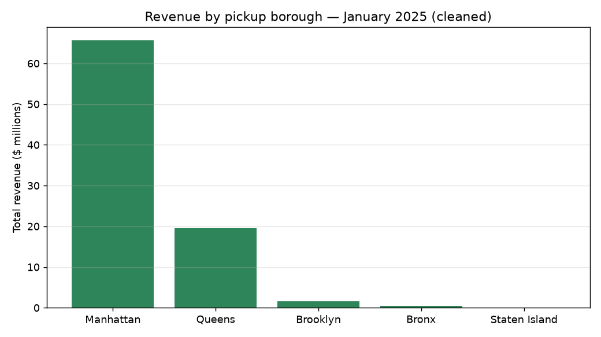
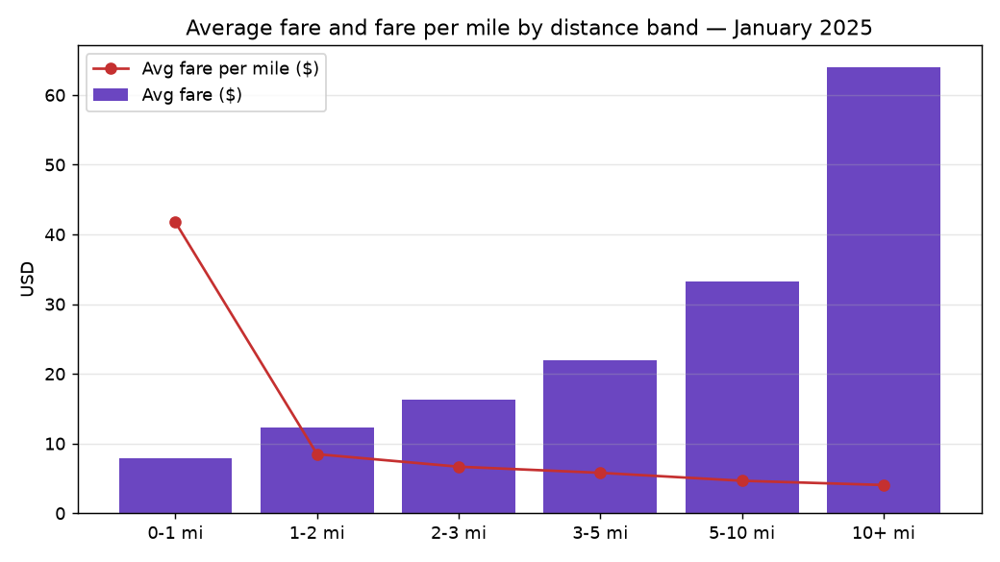
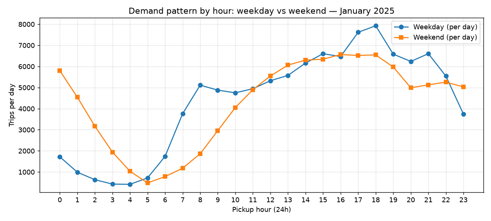

# NYC Taxi ETL — Cleaning a Messy Month of Trip Data

An end-to-end ETL project on real New York City yellow taxi data: 3.48 million raw trip records for January 2025, profiled, cleaned with documented rules, loaded into a SQLite star schema, and analyzed with SQL.

## Business problem

A taxi fleet operator (or the city) wants to answer basic planning questions from trip data: When is demand highest? Where does the revenue actually come from? Are airport trips worth positioning cars for? How do weekends differ from weekdays?

The problem is that the raw TLC trip feed cannot be trusted as-is. It contains refund records mixed in with real trips, meters that recorded zero miles, clocks that ran backwards, and one "trip" of 276,423 miles. Any answer computed straight from the raw file would be wrong. So most of this project is the unglamorous part: finding what is broken, deciding what to do about it, and documenting every decision.

## The data

Source: NYC Taxi & Limousine Commission (TLC) trip records, January 2025 — one monthly parquet file plus the TLC taxi zone lookup (265 zones).

- **Raw rows: 3,475,226**
- **Cleaned rows: 3,226,518** (248,708 removed, 7.2% — every removal is logged by rule)

### What was wrong with it (counted on the raw file)

| Problem | Rows |
|---|---|
| Negative fare amount (refunds/voids recorded as trips) | 144,118 |
| Zero fare amount | 1,398 |
| Negative total amount | 63,037 |
| Trip distance recorded as 0.00 miles (75,846 of them still charged a fare) | 90,893 |
| Longest "trip distance" in the file: **276,423.57 miles**; 162 rows over 100 miles | 162 |
| Dropoff time at or before pickup time | 2,051 |
| Implied average speed over 100 mph (899 rows); over 65 mph (1,090 rows) | 1,090 |
| Pickup timestamp outside January 2025 | 22 |
| Passenger count of 0 (where reported) | 24,656 |
| Negative tip amount | 124 |
| Largest fare in the file: **$863,372.12**; longest duration: **5,626 minutes** | — |

One structural issue mattered more than any single bad value: **540,149 rows (15.5%) are "Flex Fare" trips (payment_type = 0), and for that entire block the feed never reports passenger count, rate code, congestion surcharge, or airport fee.** Those fields are null for the whole block. I kept those trips — they are real, paid trips — and stored passenger count as NULL (unknown) rather than dropping 15% of the month or making up a number. 412,887 of them survive cleaning.

For balance, some things were *not* wrong: no missing pickup/dropoff zone IDs, every zone ID matched the official lookup, and there were zero exact duplicate rows.

## What I did

**Extract** — Downloaded the January 2025 yellow taxi parquet file and the zone lookup CSV from the TLC's official distribution site.

**Transform** — `clean_data.py` applies 10 rules in order and logs how many rows each one removes:

| # | Rule | Rows removed |
|---|---|---|
| 1 | Pickup timestamp outside January 2025 | 22 |
| 2 | Dropoff at/before pickup (duration ≤ 0) | 2,051 |
| 3 | Duration over 180 minutes (meter left running; 99.9% of real trips are under 99 min) | 1,377 |
| 4 | Fare ≤ $0 (refunds, voids, no-charge records) | 145,441 |
| 5 | Total amount ≤ $0 | 22 |
| 6 | Negative tip (all 124 raw cases were already caught by rules 4–5) | 0 |
| 7 | Trip distance ≤ 0 (no movement recorded) | 75,171 |
| 8 | Trip distance > 100 miles | 131 |
| 9 | Implied average speed > 65 mph (impossible across a full NYC trip) | 912 |
| 10 | Passenger count 0 or > 6, where reported (a cab carries at most 6) | 23,581 |

**Load / model** — Cleaned data goes into SQLite (`nyc_taxi.db`) as a small star schema:

- `fact_trips` — 3,226,518 rows: timestamps, pickup hour, day of week, weekend flag, passenger count (nullable), distance, zones, payment type, fare/tip/tolls/total, trip duration.
- `dim_zones` — 265 rows: LocationID, borough, zone, service zone.

**Analyze** — `queries.sql` holds 7 business queries; `run_queries.py` executes them and writes the actual output to `query-results.md`. Every number below comes from that output. `make_charts.py` builds the charts from the same database.

## Key findings (January 2025, cleaned data)

- **3,226,518 trips produced $87,419,164.92 in total charges.** The average trip: $27.09 total ($18.23 fare), 3.17 miles, 14.7 minutes.
- **Demand peaks at 6 PM** (234,666 trips, 7.3% of the month) and bottoms out at 4 AM (17,833 trips, 0.6%). Volume builds from 7 AM and stays high all afternoon and evening — there is no midday lull worth cutting cars for.
- **Manhattan is the volume, airports are the money.** Manhattan pickups are 89.3% of all trips (2,882,613) but average only $22.76 per trip over 2.27 miles. Airport trips (JFK, LaGuardia, Newark) are just 8.5% of trips (275,546) yet produced **$22,139,051.32 — 25.3% of all revenue**. JFK trips average $82.30, and the JFK Airport zone alone took in $10,857,146.09 from 134,182 pickups — the highest-revenue pickup zone in the city, ahead of every Manhattan zone.
- **Short trips are the most expensive per mile.** Fare per mile falls steadily with distance: $41.74/mile for trips under 1 mile (the flag-drop dominates) down to $4.05/mile for trips over 10 miles.
- **Credit card is the default, and its tips are generous.** 74.5% of trips were paid by card, with an average tip of $4.10 — 26.3% of the fare. Cash trips show $0.00 in recorded tips, which does not mean cash riders don't tip: the meter simply doesn't record cash tips, so this dataset cannot measure them.
- **Weekends run later, not bigger.** Trips per day are nearly identical (weekday ≈ 104,470/day, weekend ≈ 102,965/day), but the shape differs: weekdays peak at the morning commute and 5–6 PM rush, while weekend demand stays high past midnight. Weekend trips are slightly longer (3.22 vs 3.15 miles) and carry more passengers per trip where reported (1.41 vs 1.27), but average $1.55 less per trip.






## Recommendation

If I were advising a fleet operator from this data:

1. **Staff to the evening, not the morning.** The single biggest demand block is 5–7 PM. Cars and drivers should be positioned for the evening peak first.
2. **Treat airport positioning as a revenue decision, not a volume decision.** Airport trips are a small share of rides but a quarter of the money. A driver who skips airport queues because "there are fewer trips" is skipping the highest-value work in the system ($82.30 average at JFK vs $22.76 for a Manhattan pickup).
3. **Shift weekend coverage later.** Weekend demand doesn't need more cars at 8 AM; it needs them between 10 PM and 2 AM.

And one data recommendation: any team using this feed should budget real time for cleaning. 7.2% of the raw file was unusable, and the errors are not random — refunds, meter glitches, and an entire payment category with unreported fields would quietly distort revenue and passenger numbers if nobody checked.

## Tools

- **Python / pandas** — profiling and cleaning (`clean_data.py`)
- **SQLite / SQL** — star schema and all analysis (`queries.sql`)
- **matplotlib** — charts (`make_charts.py`)
- Data: NYC TLC trip records (parquet) + TLC taxi zone lookup

## How to run

```bash
# 1. Download the raw data into data/ (not tracked in git — the parquet is ~59 MB)
mkdir -p data
curl -o data/yellow_tripdata_2025-01.parquet \
  https://d37ci6vzurychx.cloudfront.net/trip-data/yellow_tripdata_2025-01.parquet
curl -o data/taxi_zone_lookup.csv \
  https://d37ci6vzurychx.cloudfront.net/misc/taxi_zone_lookup.csv

# 2. Install dependencies
pip install pandas pyarrow matplotlib

# 3. Clean and load (prints the per-rule removal log)
python clean_data.py        # writes nyc_taxi.db

# 4. Run the analysis queries and regenerate the results file
python run_queries.py       # writes query-results.md

# 5. Build the charts
python make_charts.py       # writes charts/*.png
```

---

*Abatar Bhattarai — CIS senior at East Texas A&M University. More projects: github.com/AbatarBhattarai*
